<picture>
  <source media="(prefers-color-scheme: dark)" srcset="https://skillicons.dev/icons?i=ts%2Cjs%2Cpy%2Cphp%2Crust%2Ckotlin%2Cswift%2Ccpp%2Ccss%2Csass%2Cbash&theme=dark">
  
</picture>
 
<picture>
  <source media="(prefers-color-scheme: dark)" srcset="https://skillicons.dev/icons?i=nextjs%2Creact%2Cvue%2Cnuxtjs%2Cpinia%2Ctailwind%2Cthreejs%2Cnodejs%2Cnestjs%2Cexpress%2Cfastapi%2Cdiscordjs&theme=dark">
  
</picture>
 
<picture>
  <source media="(prefers-color-scheme: dark)" srcset="https://skillicons.dev/icons?i=postgres%2Cmongodb%2Cmysql%2Credis%2Cprisma%2Cdocker%2Cnginx%2Cvite%2Cvitest&theme=dark">
  
</picture>

# flipkips

web apps, bots and automation

 

<picture>
  <source media="(prefers-color-scheme: dark)" srcset="assets/languages-dark.svg">
  
</picture>

 

### ❄️ Featured

<table>
<tr>
<td width="50%" valign="top">

</td>
<td valign="top">

**[desktop-snow-overlay](https://github.com/flipkips/desktop-snow-overlay)**

Snow for the Windows desktop. Flakes fall over your windows, pile up on them and above the taskbar, and the cursor knocks them off.

C++ · Direct2D · DirectComposition

</td>
</tr>
</table>
